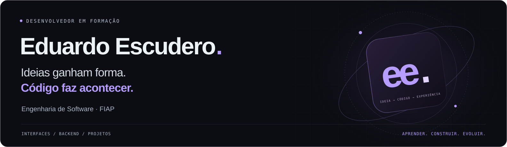
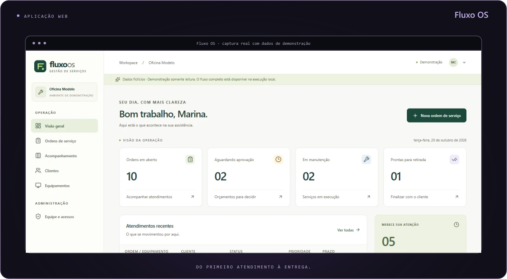
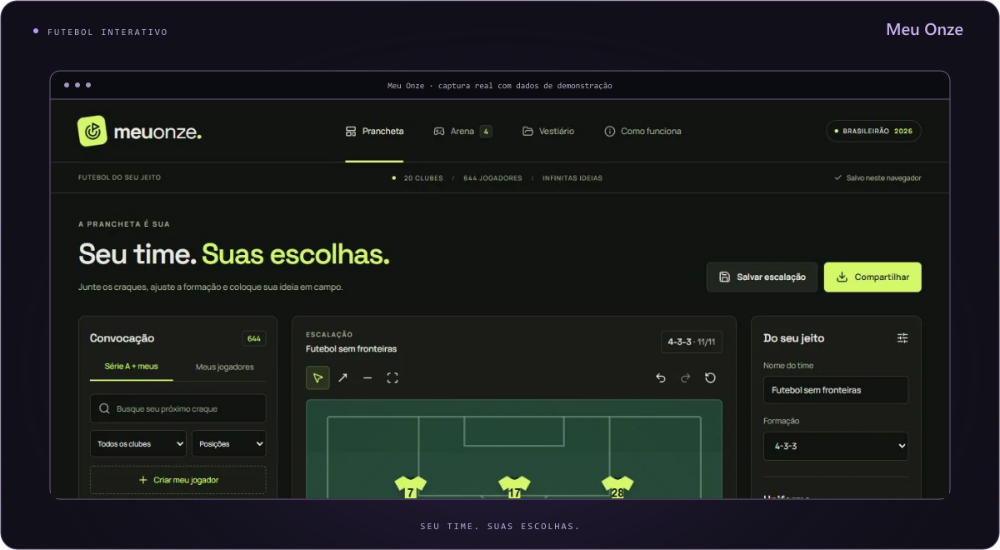
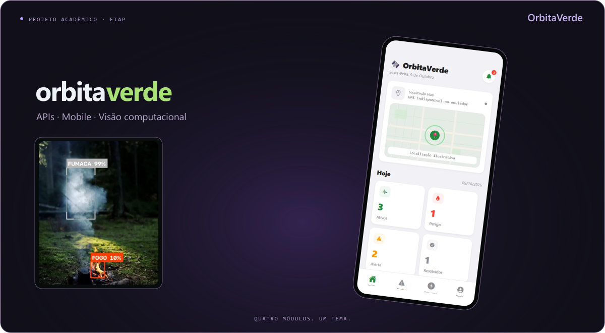
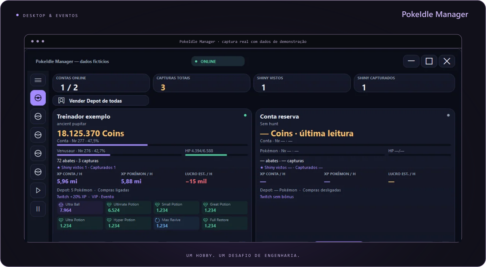
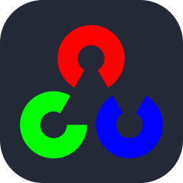
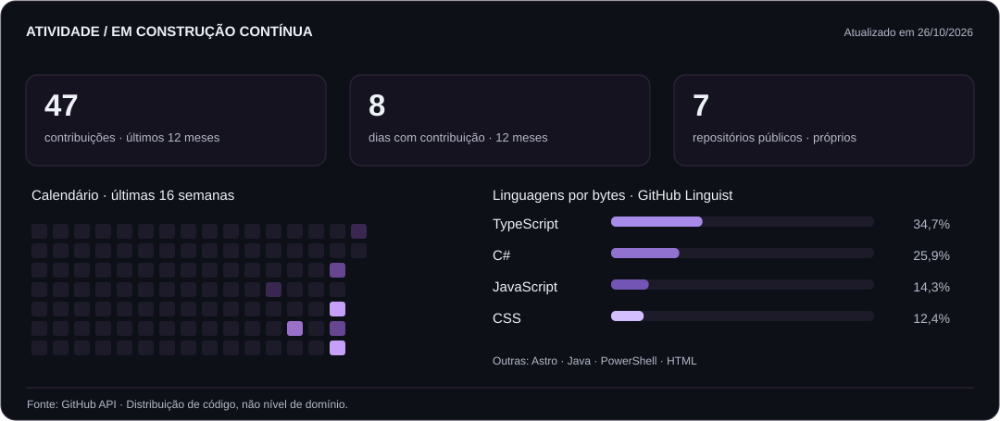

  
  

  
  
  
  

## 👋 Sobre mim

Sou **Eduardo Escudero**, estudante de **Engenharia de Software na FIAP**, com foco em desenvolvimento **full stack**. Gosto de conectar interfaces, regras de negócio e dados em aplicações que alguém possa experimentar.

- 🎓 Busco minha **primeira oportunidade de estágio em desenvolvimento de software**.
- 🛠️ Meu foco atual é **React + TypeScript** e **C#/.NET + PostgreSQL**.
- ⚽ Meu interesse por futebol também virou projeto: o **Meu Onze**.
- 🚀 Nos projetos, procuro cuidar da implementação, dos testes, da documentação e da publicação.

## 💻 Projetos pessoais e acadêmicos

Quatro propostas diferentes, com capturas reais, código disponível e decisões documentadas.

### Fluxo OS

**Do primeiro atendimento à entrega.** Gestão de ordens de serviço com orçamentos versionados, permissões por recurso e histórico. Interface, regras de negócio, API e banco em uma aplicação completa.

`React` `TypeScript` `C# / .NET` `PostgreSQL` `Docker`

**[Experimentar ↗](https://fluxo-os.onrender.com/)** · [Código e documentação](https://github.com/duduescudero/fluxo-os) · [Decisões técnicas](https://duduescudero.github.io/projetos/fluxo-os/)

Projeto pessoal · Demonstração com dados fictícios, em somente leitura.

---

### Meu Onze

**Seu time. Suas escolhas.** Prancheta interativa com jogadores da Série A, atletas personalizados, compartilhamento de escalações e quatro minigames. Um interesse pessoal transformado em uma aplicação para jogar e criar.

`React` `TypeScript` `SVG` `Zustand` `IndexedDB`

**[Entrar em campo ↗](https://duduescudero.github.io/meu-onze/)** · [Código e documentação](https://github.com/duduescudero/meu-onze) · [Decisões técnicas](https://duduescudero.github.io/projetos/meu-onze/)

Projeto pessoal · Sem cadastro, salvamento no navegador e elencos datados.

---

### OrbitaVerde

**Um problema ambiental, diferentes caminhos técnicos.** Protótipo acadêmico com quatro módulos independentes: APIs Java e C#, aplicativo mobile e detecção de fogo e fumaça em vídeo.

`Java / Spring Boot` `C# / .NET` `React Native` `Python / OpenCV`

**[Conhecer o projeto ↗](https://duduescudero.github.io/projetos/orbita-verde/)** · [Código e documentação](https://github.com/duduescudero/orbita-verde) · [Decisões técnicas](https://duduescudero.github.io/projetos/orbita-verde/)

Projeto acadêmico · FIAP · Demonstrações e instruções por módulo.

---

### PokeIdle Manager

**Um hobby que virou um desafio de engenharia.** Gerenciador desktop com múltiplas sessões, métricas, reconexão e operações que aguardam confirmação. Demonstração offline com dados fictícios.

`Node.js` `JavaScript` `C# / Windows Forms` `WebSocket`

**[Conhecer o projeto ↗](https://duduescudero.github.io/projetos/pokeidle-manager/)** · [Código e documentação](https://github.com/duduescudero/pokeidle-manager) · [Decisões técnicas](https://duduescudero.github.io/projetos/pokeidle-manager/)

Projeto pessoal · Aplicação desktop · Demonstração executada localmente.

---

O **[portfólio](https://duduescudero.github.io/)** reúne os casos de estudo, capturas e aprendizados. Ele também é um projeto: **Astro, TypeScript, acessibilidade, identidade própria e efeitos opcionais**. [Ver código ↗](https://github.com/duduescudero/duduescudero.github.io)

## 🛠️ Tecnologias nos meus projetos

<strong>Frontend</strong>

  
  
  
  
  
  

<strong>Backend e dados</strong>

  
  
  
  
  
  

<strong>Ferramentas e validação</strong>

  
  
  
  

<strong>Mobile e visão computacional</strong>

  
  
  

Também nos projetos: Entity Framework Core · Playwright · Windows Forms.

## 📊 Atividade e evolução

<picture>
  <source media="(max-width: 600px) and (prefers-color-scheme: light)" srcset="assets/activity/summary-mobile-light.svg" />
  <source media="(max-width: 600px)" srcset="assets/activity/summary-mobile-dark.svg" />
  <source media="(prefers-color-scheme: light)" srcset="assets/activity/summary-light.svg" />
  
</picture>

  <picture>
    <source media="(prefers-reduced-motion: reduce)" srcset="assets/activity/calendar-static.svg" />
    <source media="(prefers-color-scheme: light)" srcset="assets/activity/snake-light.svg" />
    
  </picture>

Atualização diária pelo GitHub Actions. As linguagens representam bytes de código nos repositórios públicos analisados. <a href="assets/activity/calendar-static.svg">Ver calendário estático</a> · <a href="docs/maintenance.md">Como os dados são calculados</a>

## ✉️ Vamos conversar

Busco uma oportunidade de **estágio em desenvolvimento de software**, para contribuir com uma equipe e continuar evoluindo com projetos reais.

**[eduardoescudero911@gmail.com](mailto:eduardoescudero911@gmail.com)** · **[Portfólio](https://duduescudero.github.io/)** · **[LinkedIn](https://www.linkedin.com/in/eduardo-pires-escudero/)**

Projetos pessoais e acadêmicos desenvolvidos com apoio de IA. Decisões, validações e limites estão documentados nos repositórios. [Créditos visuais](docs/credits.md).
